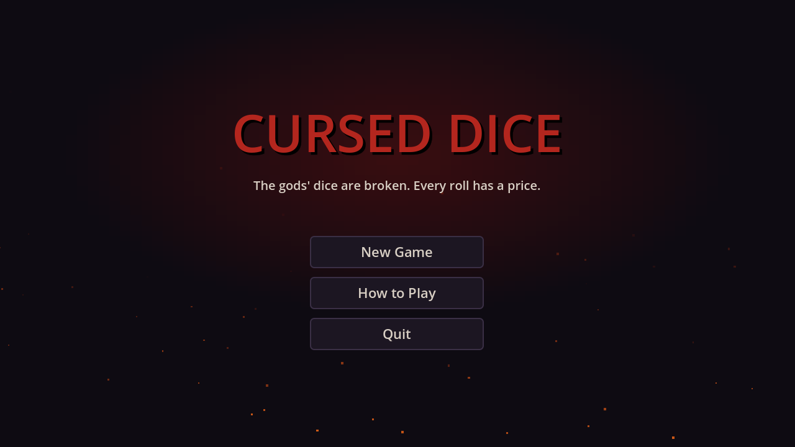
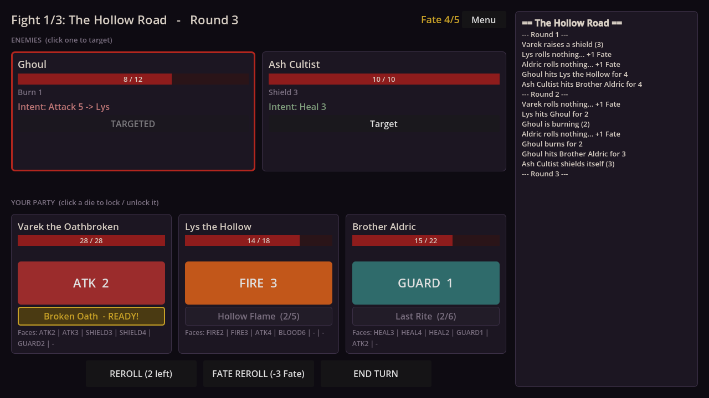

# Cursed Dice: ลูกเต๋าต้องสาป

เกมผจญภัยดาร์กแฟนตาซี ต่อสู้ด้วยลูกเต๋า ภาพ 2D pixel art สร้างด้วย Godot 4 (Prototype 0.2)




## วิธีเปิดเกม (ครั้งแรก)
1. ดาวน์โหลด **Godot 4** (เวอร์ชัน 4.3 ขึ้นไป แบบ *Standard* ไม่ใช่ .NET) จาก https://godotengine.org/download
   ไม่ต้องติดตั้ง แตกไฟล์ zip แล้วเปิดได้เลย
2. เปิด Godot → กด **Import** → เลือกไฟล์ `project.godot` ในโฟลเดอร์นี้
3. กดปุ่ม ▶️ (มุมขวาบน) หรือกด **F5** เพื่อเล่น

## วิธีเล่น
- เต๋าของฮีโร่ 3 ตัวทอยให้อัตโนมัติ **คลิกที่เต๋าเพื่อล็อก** ลูกที่อยากเก็บไว้
- กด **REROLL** เพื่อทอยลูกที่ไม่ได้ล็อกใหม่ (2 ครั้งต่อรอบ)
- คลิก **Target** เลือกศัตรูที่จะตี
- ดู **Intent** ของศัตรูว่ารอบหน้ามันจะตีใคร แล้ววางแผนตั้งรับหรือบุก
- หน้าชนิดเดียวกัน 2 ลูกได้ +1 ถ้า 3 ลูกได้ x2
- หน้าว่างให้ **Fate** สะสม 3 แต้มแลกทอยใหม่เพิ่ม
- **สกิลพิเศษ:** ฮีโร่ชาร์จพลังทุกรอบ (ได้เร็วขึ้นถ้าเข้าคอมโบ) พอปุ่มสกิลเรืองสีทองแปลว่าใช้ได้ แต่ทุกสกิลมีราคา
- ชนะ 3 ไฟต์ (ไฟต์สุดท้ายคือบอส) = จบเดโม

## ทำงานกับทีม AI
เปิดโฟลเดอร์นี้ใน Claude Code แล้วสั่งงานเป็นภาษาไทยได้เลย AI จะอ่าน `CLAUDE.md` เองว่าเกมนี้คืออะไร
ทีม AI อยู่ใน `.claude/agents/`:

| สมาชิก | สั่งงานแบบไหน (ตัวอย่าง) |
|---|---|
| `game-designer` | "ให้ game-designer ออกแบบฮีโร่สายโจรเพิ่ม 1 ตัว" |
| `programmer` | "ให้ programmer ทำระบบสกิลพิเศษตาม GDD" |
| `writer` | "ให้ writer เขียนประวัติของ Varek" |
| `art-director` | "ให้ art-director เขียน prompt สำหรับวาด Ghoul" |
| `qa-tester` | "ให้ qa-tester ตรวจหาบั๊กระบบต่อสู้" |

## โครงสร้างโปรเจกต์
| โฟลเดอร์ | คืออะไร |
|---|---|
| `data/` | ข้อมูลฮีโร่ มอนสเตอร์ ด่าน (แก้ตัวเลขที่นี่ได้เลย ไม่ต้องแตะโค้ด) |
| `scripts/core/` | กฎของเกม (ระบบต่อสู้) |
| `scripts/ui/` | หน้าจอ |
| `tests/` | เทสต์อัตโนมัติ + จำลองการเล่น 300 รอบเพื่อดูความยาก |
| `docs/` | เอกสารออกแบบเกม (GDD) และแนวทางภาพ/เสียง |

## รันเทสต์
```bash
godot --headless --path . -s tests/run_tests.gd
```
