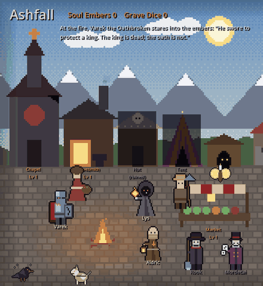
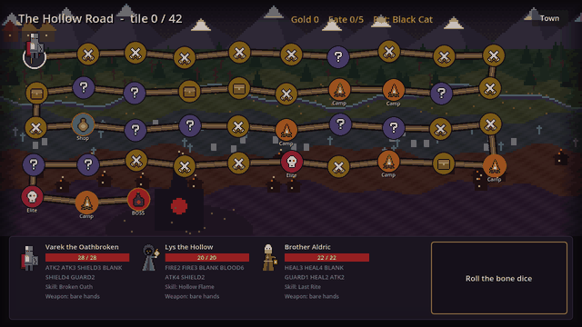
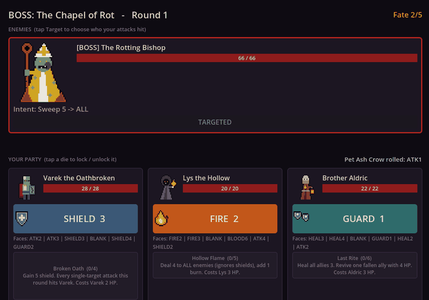

# Cursed Dice: ลูกเต๋าต้องสาป — เวอร์ชัน 1.4

เกมโร้กไลต์ดาร์กแฟนตาซี ต่อสู้ด้วยลูกเต๋า 2D สร้างด้วย Godot 4
ภูมิภาคแรก **The Hollow Road** เล่นจบได้ครบ: เมือง → ถนน 42 ช่อง → บอส The Rotting Bishop





## วิธีเปิดเกม
1. ดาวน์โหลด **Godot 4.3+** (Standard) จาก https://godotengine.org/download (แตก zip แล้วเปิดได้เลย)
2. เปิด Godot → **Import** → เลือก `project.godot` → กด **F5**
3. สร้างไฟล์สำหรับมือถือ: ดู [docs/BUILD_ANDROID.md](docs/BUILD_ANDROID.md)

## เล่นอย่างไร (ฉบับสั้น)
- **เมือง Ashfall**: เลือกทีม 3 ฮีโร่, สร้างอาคาร (Soul Embers), สุ่ม Summon Roll (Grave Dice), ดูเควสต์, เลือก Curse level
- **ถนน**: ทอยเต๋า 2 ลูก เลือก 1 ลูกเดิน → ไฟต์ / Elite / เหตุการณ์ / หีบ / ร้าน / แคมป์
- **ต่อสู้**: แตะเต๋าเพื่อล็อก, ทอยใหม่ 2 ครั้ง, ดู Intent ศัตรู, เลือกเป้า, กด END TURN
  - หน้าเหมือนกัน 2 ลูก +1, 3 ลูก x2 · หน้าว่าง/คอมโบ/ชนะ ให้ **Fate** · 2 Fate = ทอยใหม่, 4 Fate = **Twist** เลือกหน้าเอง
  - สกิลฮีโร่ชาร์จทุกรอบ ทุกพลังมีราคา
- **สร้างเต๋า**: ชนะแล้วแกะสลักหน้าเต๋า (หน้า 1-4) · อาวุธแทนหน้า 5-6 · สัตว์เลี้ยงมีเต๋า d4
- เกมเซฟอัตโนมัติ ปิดแล้วกลับมาเล่นต่อได้

## ทีม AI และวงจรทดสอบ
ทีม AI อยู่ใน `.claude/agents/`: `game-designer`, `programmer`, `writer`, `art-director`, `qa-tester`, `playtester`

ทุกเวอร์ชันผ่านวงจรนี้:
1. บอท 3 สไตล์ (มือใหม่ / นักวางแผน / สายบ้าระห่ำ) เล่น 300 รันต่อสไตล์ + แคมเปญ 20 รัน
2. ทีมนักวิจารณ์ AI 4 คนอ่านบันทึกการเล่นจริงแล้ววิจารณ์ → `docs/playtests/<เวอร์ชัน>/critique.md`
3. แก้ตามคำวิจารณ์ → เวอร์ชันถัดไป

```bash
tools/run_tests.sh
```
```bash
godot --headless --path . -s tools/playtest.gd -- v1.0
```
```bash
godot --headless --path . -s tools/hero_check.gd
```

## โครงสร้าง
| โฟลเดอร์ | คืออะไร |
|---|---|
| `data/` | เนื้อหาทั้งหมด (ฮีโร่ มอนสเตอร์ อาวุธ สัตว์ เหตุการณ์ เมือง เควสต์ กาชา) แก้ตัวเลขได้โดยไม่แตะโค้ด |
| `scripts/core/` | กฎเกม: combat, run (แผนที่), profile (เมือง/เซฟ) |
| `scripts/ui/` | หน้าจอ + เสียงสังเคราะห์ |
| `assets/icons/` | ไอคอนพิกเซลหน้าเต๋า (สร้างจาก `tools/make_icons.py`) |
| `tests/`, `tools/` | เทสต์อัตโนมัติ, บอท, สคริปต์ตรวจสมดุล |
| `docs/` | GDD, แนวทางภาพ/เสียง, รายงานการทดสอบทุกเวอร์ชัน |
